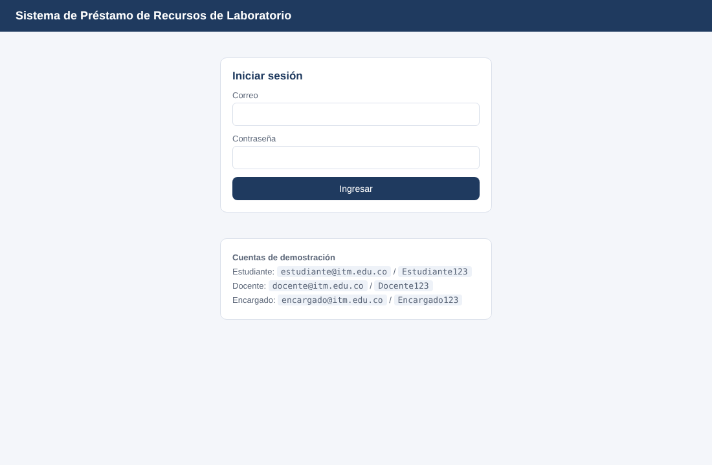
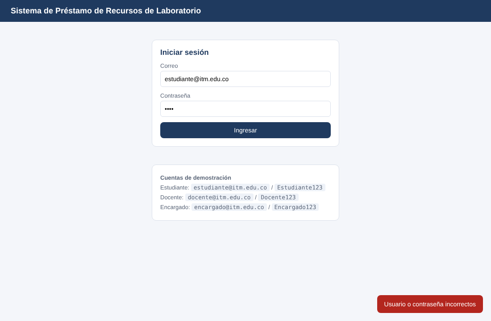
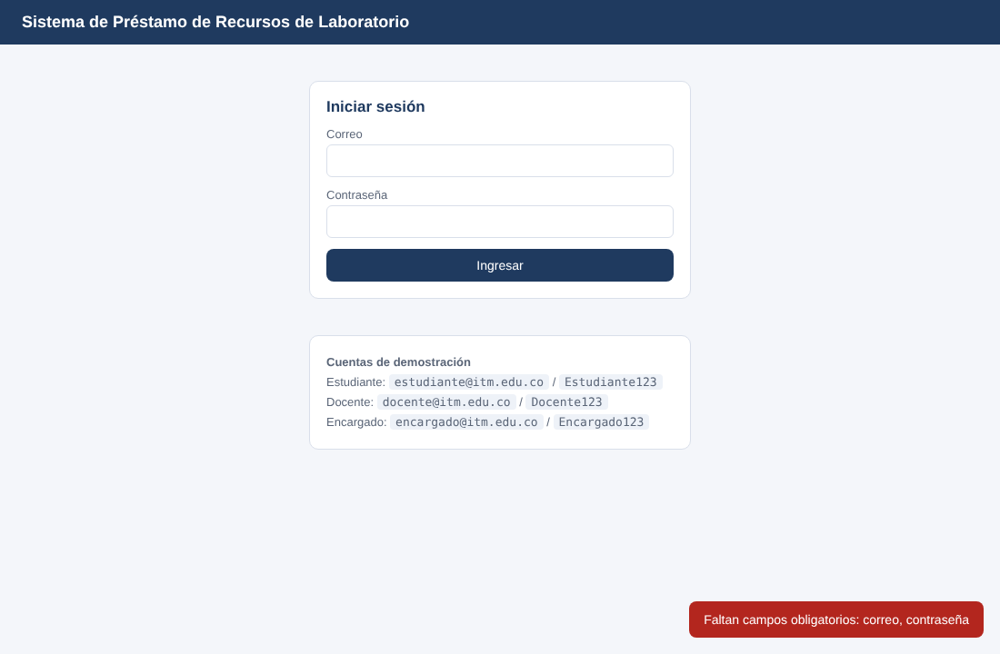
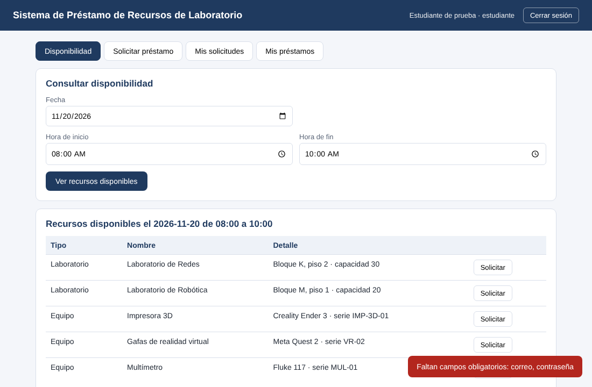
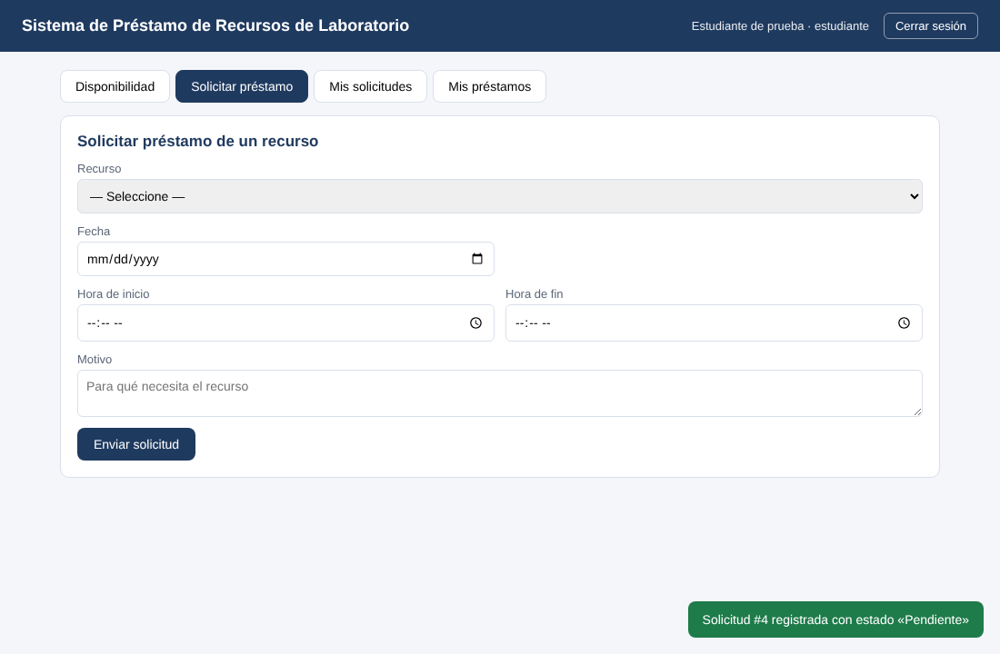
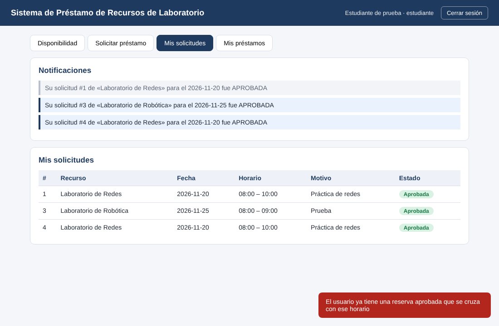
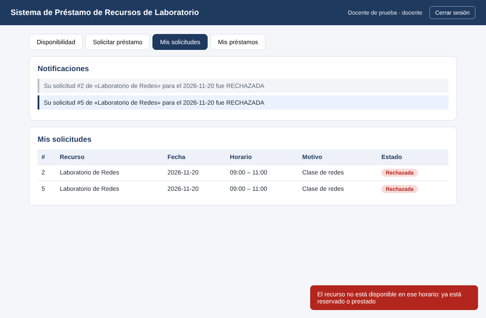
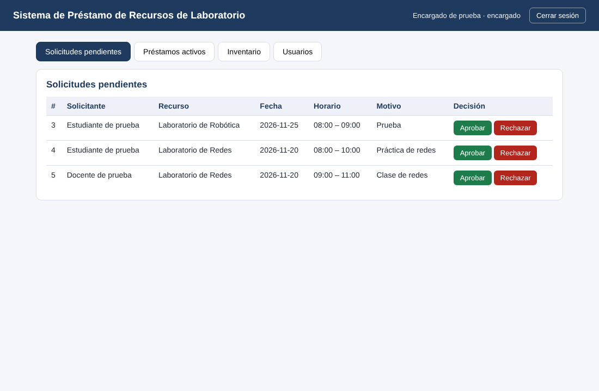
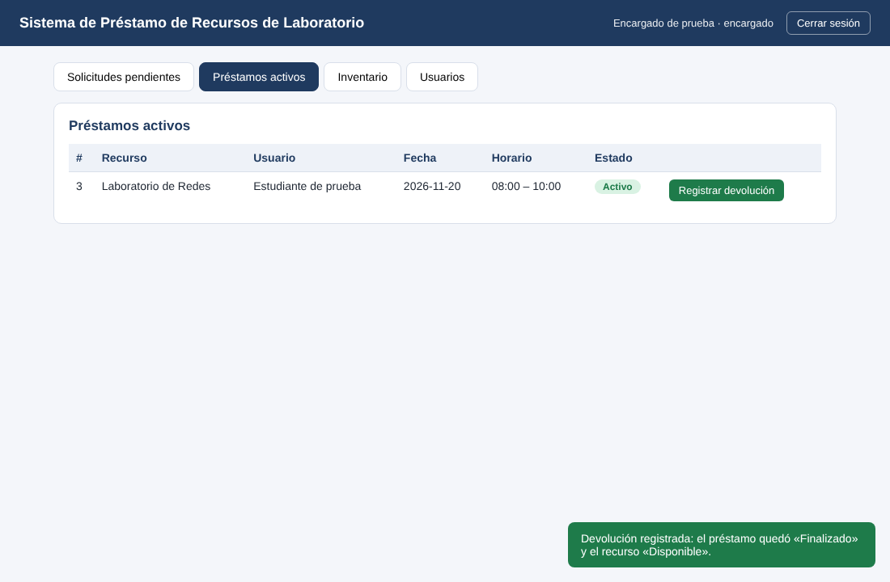

# Manual de Usuario — Sistema de Préstamo de Recursos de Laboratorio

**Versión:** 1.0 (MVP — Entregable 3)  
**Institución:** Instituto Tecnológico Metropolitano (ITM) — Diseño de Sistemas de Información  
**URL de acceso local:** `http://localhost:8080`

---

## 1. Propósito y Alcance

Este manual describe la operación paso a paso de la aplicación web para consultar disponibilidad, solicitar, aprobar, rechazar y devolver laboratorios y equipos, así como administrar inventario y usuarios según el rol asignado.

### Cuentas de Demostración

Al iniciar la aplicación con la base de datos vacía, el sistema precarga tres cuentas de prueba:

| Rol | Correo Electrónico | Contraseña | Permisos Principales |
| :--- | :--- | :--- | :--- |
| **Estudiante** | `estudiante@itm.edu.co` | `Estudiante123` | Consultar disponibilidad, registrar solicitudes de préstamo, ver notificaciones y consultar sus propios préstamos. |
| **Docente** | `docente@itm.edu.co` | `Docente123` | Consultar disponibilidad, registrar solicitudes de préstamo, ver notificaciones y consultar sus propios préstamos. |
| **Encargado** | `encargado@itm.edu.co` | `Encargado123` | Aprobar o rechazar solicitudes pendientes, registrar devoluciones, administrar laboratorios/equipos y crear cuentas de usuario. |

---

## 2. Inicio de Sesión y Control de Acceso (`HU-09`)

1. Abra el navegador e ingrese a **`http://localhost:8080`**.
2. Digite su **correo electrónico** institucional y su **contraseña**, luego haga clic en **Ingresar**.
3. El sistema valida las credenciales y carga únicamente los módulos autorizados para su rol.

### Validaciones en el Acceso
* **Credenciales incorrectas:** Si el usuario no existe o la contraseña no coincide, el sistema bloquea el ingreso y muestra una alerta clara (`02_login_error.png`).
* **Campos vacíos:** Si intenta ingresar sin diligenciar el correo o la contraseña, se indican los campos obligatorios faltantes (`03_login_vacio.png`).

| Error de credenciales | Validación de campos vacíos |
| :---: | :---: |
|  |  |

---

## 3. Guía para Estudiantes y Docentes (`HU-01` a `HU-05`)

### 3.1 Consultar disponibilidad de recursos (`HU-01`)
1. En el panel principal, ingrese a la sección **Disponibilidad**.
2. Seleccione la **fecha**, la **hora de inicio** y la **hora de fin** en que requiere el recurso y presione **Consultar**.
3. El listado mostrará únicamente los laboratorios y equipos libres en ese intervalo (excluyendo los que tienen reservas aprobadas o préstamos activos sin devolución).

> **Nota operativa:** Si un equipo fue prestado y aún no se registra su devolución, tampoco aparecerá disponible en consultas posteriores (`capturas/19_disponibles_sin_lab_redes.png`).

### 3.2 Solicitar préstamo de un recurso (`HU-02` y `HU-03`)
1. Desde la lista de recursos disponibles (o desde el formulario de solicitud), seleccione el **laboratorio o equipo**, confirme la **fecha** y el **rango horario**, escriba el **motivo de la práctica** y haga clic en **Enviar solicitud**.
2. La solicitud quedará registrada con estado **`Pendiente`** a la espera de revisión por parte del encargado.

#### Reglas y bloqueos automáticos al solicitar
* **Campos obligatorios (`HU-02`):** No se permite enviar solicitudes sin recurso, fecha, horas o motivo (`capturas/07_campos_vacios.png`).
* **Horarios inválidos (`HU-02`):** Se rechazan fechas pasadas (`capturas/08_fecha_pasada.png`) o rangos donde la hora de fin sea anterior o igual a la hora de inicio (`capturas/09_fin_antes_inicio.png`).
* **Recurso ya reservado (`HU-03`):** Si el recurso ya tiene una solicitud aprobada que se cruza con el horario pedido, el sistema bloquea el registro (`capturas/14b_hu03_esc1_recurso_reservado.png`).
* **Doble reserva del mismo usuario (`HU-03`):** Un solicitante que ya tiene una reserva aprobada en un horario no puede solicitar otro recurso en el mismo intervalo (`capturas/14c_hu03_esc3_mismo_usuario.png`).

### 3.3 Revisar notificaciones de estado (`HU-04`)
1. Al iniciar sesión, consulte el panel de **Notificaciones**.
2. Cada vez que el encargado apruebe o rechace una de sus solicitudes, aparecerá el aviso correspondiente con el detalle del recurso y el horario.

| Notificación de aprobación | Notificación de rechazo |
| :---: | :---: |
|  |  |

### 3.4 Consultar el estado de mis préstamos (`HU-05`)
1. Ingrese a la pestaña **Mis préstamos**.
2. Visualice el historial de sus recursos asignados diferenciados por estado:
   * **`Activo`:** El recurso está aprobado y en uso (`capturas/17_mis_prestamos_activo.png`).
   * **`Finalizado`:** El recurso ya fue entregado y el encargado registró su devolución (`capturas/22_prestamo_finalizado.png`).
   * Si aún no ha tenido préstamos, el sistema muestra un mensaje informativo (`capturas/18_mis_prestamos_vacio.png`).

---

## 4. Guía para el Encargado de Laboratorio (`HU-06`, `HU-07`, `HU-08`, `HU-10`)

### 4.1 Aprobar o rechazar solicitudes pendientes (`HU-07`)
1. Abra la sección **Solicitudes pendientes** (ordenadas por orden de llegada).
2. Revise el solicitante, el recurso, la fecha, el horario y el motivo:
   * Haga clic en **Aprobar** para autorizar el uso. La solicitud pasa a **`Aprobada`**, se crea automáticamente un préstamo **`Activo`** y se notifica al solicitante (`capturas/12_aprobada_1.png`).
   * Haga clic en **Rechazar** para denegar la petición. La solicitud pasa a **`Rechazada`** y se notifica al solicitante (`capturas/14_rechazada.png`).
3. **Control de cruces:** Si existen dos solicitudes pendientes para el mismo recurso y horario, una vez aprobada la primera, el sistema bloqueará la aprobación de la segunda por conflicto de horario (`capturas/13_aprobar_cruzada_bloqueada.png`).

### 4.2 Registrar devolución de un recurso (`HU-08`)
1. Ingrese a la sección **Préstamos activos** (`capturas/20_prestamos_activos.png`).
2. Ubique el préstamo correspondiente al equipo o laboratorio que está siendo entregado y presione **Registrar devolución**.
3. El préstamo cambiará a estado **`Finalizado`** con la fecha y hora de retorno, y el recurso volverá a quedar **`Disponible`** para nuevas reservas.

### 4.3 Administrar inventario de laboratorios y equipos (`HU-06`)
1. Acceda al módulo **Inventario** (`capturas/23_inventario.png`).
2. **Registrar recurso:** Complete el nombre, tipo (`Laboratorio` o `Equipo`), código/ubicación y guarde; el recurso quedará activo con estado **`Disponible`** (`capturas/24_recurso_registrado.png`).
3. **Editar o eliminar recurso:** Puede actualizar los datos de cualquier recurso o eliminarlo siempre que no tenga préstamos activos ni solicitudes pendientes o aprobadas. Si tiene trámites vigentes, el sistema impedirá su eliminación (`capturas/25_eliminar_con_vigentes.png`).

### 4.4 Registrar y administrar usuarios (`HU-10`)
1. Ingrese al módulo **Usuarios**.
2. Para crear una cuenta nueva, diligencie el nombre, el correo electrónico, la contraseña inicial y seleccione el rol (`Estudiante`, `Docente` o `Encargado`), luego presione **Crear usuario** (`capturas/26_usuario_creado.png`).
3. **Validaciones:** El sistema impide registrar correos electrónicos duplicados (`capturas/27_correo_duplicado.png`) o guardar usuarios sin rol o con campos obligatorios vacíos (`capturas/28_usuario_sin_rol.png`).

---

## 5. Soporte y Contacto

Para incidencias técnicas relacionadas con el acceso o el inventario de laboratorios, consulte la sección **Contacto** dentro de la aplicación (`capturas/contacto.png`) o comuníquese con el encargado de laboratorio asignado.
